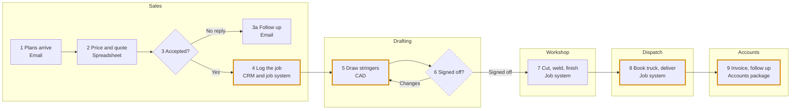
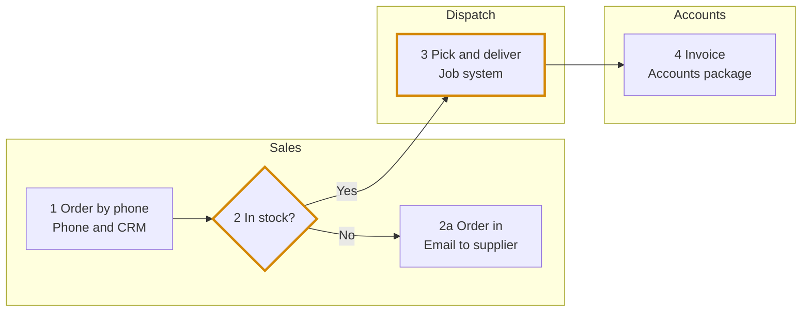

# The file for Adam

One Markdown file, named `walkthrough-<business-slug>-<YYYY-MM-DD>.md` (the business name in
lowercase with hyphens, and today's date). The block at the top is for APG's tools; the sections
under it are for a person. Write every section, in this order.

## Rules

- **This file is an index, not the record.** The meeting recording is the evidence for what was
  said. This file says what the room confirmed, so APG can find it in the recording and plan the
  team sessions from it.
- **Every line ends with one mark:**
  - `confirmed in the room`: the room said it, or confirmed it on the page;
  - `from their documents`: from a file they dropped in, or their starter page, and not
    contradicted;
  - `from the website`: read from their website, and not contradicted;
  - `assumed`: a default you applied because nobody knew; also listed under the header's
    `assumed`;
  - `UNCONFIRMED`: they weren't sure, or the room disagreed (View A / View B); also on the parking
    list.
- **The typical-job swimlanes are not reference jobs.** They describe how a typical job moves, not
  any specific job. Write `reference_jobs: none` in the header, always.
- **No names, emails, phone numbers or counts of people.** Teams by role ("led by the Design
  Manager"). Customers and suppliers as "builder A", "supplier A". Offshore as a place.
- **No time, pay or volume figures.** If someone offered one, write it under the Questions log as
  `offered, not asked`, with no number.
- **No passwords, logins, bank or card details, ever.**
- Step numbers match the page everywhere.
- `consent_to_send` and `sent_via` are written `not asked` and `not sent` when the file is made.
  Adam downloads it in the room; if he does, set `sent_via: downloaded by Adam in the room`.

## Worked example

Ridgeline Steel is made up. Everything below is invented for illustration.

````markdown
---
walkthrough: business
walkthrough_version: 0.1.0
status: complete              # complete | incomplete
date: 2026-10-15
business: Ridgeline Steel
website: https://ridgelinesteel.example
in_the_room: [Managing Director, Sales Manager, Drafting Manager, Finance Manager]
recorded: yes                 # yes | no | declined
page_confirmed: true          # true once every part of the page got a yes
flows:
  - { name: "Stringers", runs: "made to order from drawings" }
  - { name: "Balustrade posts", runs: "supplied from stock" }
reference_jobs: none
assumed: []
unconfirmed: ["who follows up drawing sign-off"]
consent_to_send: not asked
sent_via: downloaded by Adam in the room
---

# How Ridgeline Steel works: walkthrough, 15 October 2026

## The stages

**What they make**
- Stair stringers, balustrades, balustrade posts and handrail brackets. Gates stopped last year. (confirmed in the room)

**Stringers: made to order from drawings**
- Win the job → Draft and get sign-off → Make it → Deliver it → Invoice and get paid. (confirmed in the room)

**Balustrade posts: supplied from stock**
- Take the order → Pick from stock → Deliver it → Invoice and get paid. (confirmed in the room)

**Who buys, and how work arrives**
- Builders email plans to sales; repeat customers ring the workshop. (confirmed in the room)

## Teams and sites

**Teams**
- Sales, led by the Sales Manager. (confirmed in the room)
- Drafting, led by the Drafting Manager. (confirmed in the room)
- Workshop, led by the Production Manager. (confirmed in the room)
- Dispatch, led by the Dispatch Lead. (from their documents)
- Accounts, led by the Finance Manager. (confirmed in the room)

**Sites**
- Newcastle: office and workshop. (from the website)
- Brisbane: yard and dispatch. (confirmed in the room)
- Some of the drafting team work remotely. (confirmed in the room)

## Systems by step

- Email: plans arrive (Stringers 1); orders to suppliers (Posts 2a). (confirmed in the room)
- Spreadsheet: pricing and quoting (Stringers 2). (confirmed in the room)
- CRM: logging jobs and phone orders (Stringers 4, Posts 1). (confirmed in the room)
- Job system: jobs, stock and dispatch (Stringers 4, 7, 8; Posts 2, 3). (confirmed in the room)
- CAD: drawings (Stringers 5). (confirmed in the room)
- Accounts package: invoicing (Stringers 9, Posts 4). (from their documents)

## How a typical job moves

**Stringers: made to order from drawings**

| # | Team | Step | System | Hand-off to |
|---|---|---|---|---|
| 1 | Sales | Plans arrive | Email | |
| 2 | Sales | Price and quote | Spreadsheet | |
| 3 | Sales | Accepted? Yes → 4; no reply → 3a | | |
| 3a | Sales | Follow up | Email | |
| 4 | Sales | Log the job | CRM and job system | Drafting |
| 5 | Drafting | Draw stringers | CAD | |
| 6 | Drafting | Signed off? Changes → 5; signed off → 7 | | Workshop |
| 7 | Workshop | Cut, weld, finish | Job system | Dispatch |
| 8 | Dispatch | Book truck, deliver | Job system | Accounts |
| 9 | Accounts | Invoice, follow up | Accounts package | |

- The stringer steps above, as drawn. (confirmed in the room)
- Who follows up drawing sign-off at step 6: View A Sales, View B Drafting. (UNCONFIRMED)



**Balustrade posts: supplied from stock**

| # | Team | Step | System | Hand-off to |
|---|---|---|---|---|
| 1 | Sales | Order by phone | Phone and CRM | |
| 2 | Sales | In stock? Yes → 3; no → 2a | Job system | Dispatch |
| 2a | Sales | Order in | Email to supplier | |
| 3 | Dispatch | Pick and deliver | Job system | Accounts |
| 4 | Accounts | Invoice | Accounts package | |

- The post steps above, as drawn. (confirmed in the room)



## Where work waits

- Stringers, hand-off 4 → 5 (Sales to Drafting): finding the latest drawings. (confirmed in the room)
- Stringers, hand-off 8 → 9 (Dispatch to Accounts): delivery notes typed into the accounts package again. (confirmed in the room)
- Posts, hand-off 2 → 3 (Sales to Dispatch): the stock count is checked by phone. (confirmed in the room)
- What trips a new starter up: knowing which version of the drawings is the latest. (confirmed in the room)

## Parking list

1. Who follows up drawing sign-off: Sales or Drafting? → Sales Manager and Drafting Manager
2. Does the Brisbane yard hold its own stock list? → Dispatch Lead

## Questions log

| Q | Asked | Answer, in short | Mark |
|---|---|---|---|
| Q1 | Play back | Right, except gates stopped last year | confirmed in the room |
| Q4 | Kinds of job | Stringers to order; posts from stock | confirmed in the room |
| Q8 | Sites | Newcastle, Brisbane yard, some remote | confirmed in the room |
| Q16 | Where a job waits | Between Sales and Drafting | confirmed in the room |
| — | Offered, not asked | A figure for how many jobs a month (not recorded) | offered, not asked |
````

If the walkthrough stopped early, add a **Still to ask** section after the Parking list, listing
each unasked question as `- Q12 → next time`.
